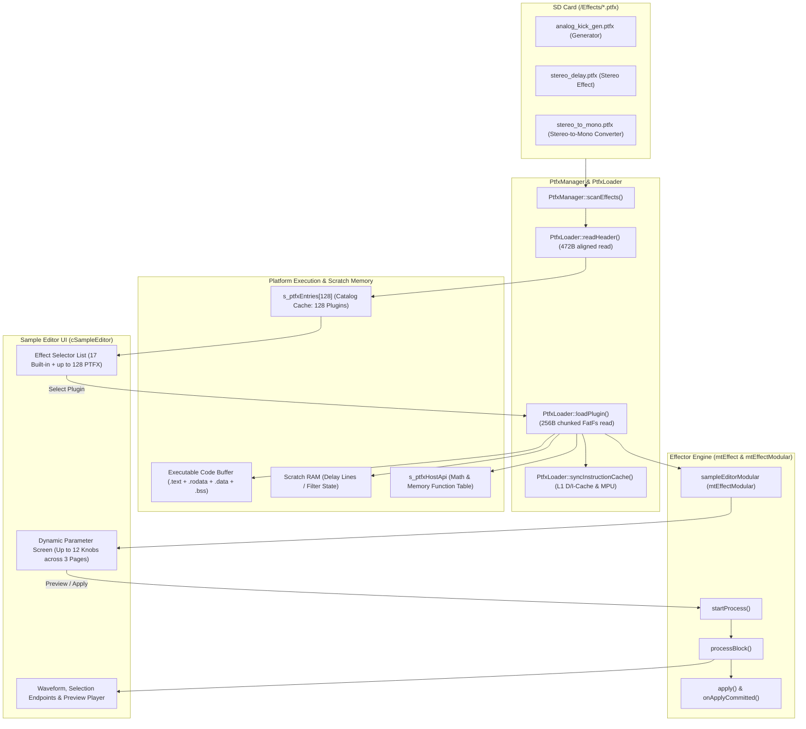

# Polyend Tracker Modular Effects System & Developer SDK (`PTFX`)

This guide covers everything needed to use, author, compile, and understand custom DSP audio effects and sample generators (`.ptfx` plugins) for **Original Polyend Tracker** (`MK66`), **Polyend Tracker+** (`IMX`), and **Polyend Tracker Mini** (`IMX`).

---

## Table of Contents

1. [Overview & Installing `.ptfx` Plugins](#1-overview--installing-ptfx-plugins)
2. [Bundled Reference Plugins (`editor-fx-sdk/effects/`)](#2-bundled-reference-plugins-editor-fx-sdkeffects)
3. [Quick Start & Anatomy of a `.ptfx` Plugin](#3-quick-start--anatomy-of-a-ptfx-plugin)
   - [SDK Contents](#sdk-contents)
   - [Building Plugins](#building-plugins)
   - [Minimal Effect Template](#minimal-effect-template)
4. [Metadata Directives & Capability Flags (`PtfxFlags`)](#4-metadata-directives--capability-flags-ptfxflags)
5. [Parameter Descriptors & UI Controls (`0`–`12` Parameters)](#5-parameter-descriptors--ui-controls-012-parameters)
   - [Continuous Float Bar (`PTFX_PARAM_FLOAT`)](#1-continuous-float-bar-ptfx_param_float)
   - [Integer Bar (`PTFX_PARAM_INT`)](#2-integer-bar-ptfx_param_int)
   - [Scrollable String List (`PTFX_PARAM_LIST`)](#3-scrollable-string-list-ptfx_param_list)
   - [File Picker & Save-File Parameters (`PTFX_PARAM_FILE` / `PTFX_PARAM_SAVE_FILE`)](#4-file-picker--save-file-parameters-ptfx_param_file--ptfx_param_save_file)
6. [Host API Reference (`PtfxHostApi`)](#6-host-api-reference-ptfxhostapi)
7. [Plugin Lifecycle & Audio Processing Patterns](#7-plugin-lifecycle--audio-processing-patterns)
   - [Lifecycle Order](#71-lifecycle-order)
   - [Pattern A: Standard In-Place Audio Effect (`PTFX_FLAG_EFFECT`)](#72-pattern-a-standard-in-place-audio-effect-ptfx_flag_effect)
   - [Pattern B: Extending Sample Length (`host->set_extra_samples`)](#73-pattern-b-extending-sample-length-host-set_extra_samples)
   - [Pattern C: Sample & Wavetable Generators (`PTFX_FLAG_GENERATOR`)](#74-pattern-c-sample--wavetable-generators-ptfx_flag_generator)
   - [Pattern D: Using Working Scratch RAM (`PTFX_SCRATCH`)](#75-pattern-d-using-working-scratch-ram-ptfx_scratch)
   - [Pattern E: Loading Secondary WAV Audio & Data Files (`PTFX_PARAM_FILE`)](#76-pattern-e-loading-secondary-wav-audio--data-files-ptfx_param_file)
   - [Pattern F: Exporting / Saving Files (`PTFX_PARAM_SAVE_FILE`)](#77-pattern-f-exporting--saving-files-ptfx_param_save_file)
8. [The `.ptfx` Binary Specification (`PtfxHeader`)](#8-the-ptfx-binary-specification-ptfxheader)
   - [Binary Layout (`PtfxHeader` - `472` Bytes)](#81-binary-layout-ptfxheader---472-bytes)
   - [Parameter Descriptor (`PtfxParamDef` - `32` Bytes)](#82-parameter-descriptor-ptfxparamdef---32-bytes)
9. [Firmware Architecture, Memory Layout & Cache Coherency](#9-firmware-architecture-memory-layout--cache-coherency)
   - [End-to-End Architecture](#91-end-to-end-architecture)
   - [Platform Resource & Memory Allocation](#92-platform-resource--memory-allocation)
   - [Cortex-M7 L1 Cache Coherency & FatFs Loading (`PLATFORM_IMX`)](#93-cortex-m7-l1-cache-coherency--fatfs-loading-platform_imx)
   - [Sample Editor Buffer Lifecycle](#94-sample-editor-buffer-lifecycle)
10. [Automatic Effect Presets (`.ptp` Files via `More` Button)](#10-automatic-effect-presets-ptp-files-via-more-button)

---

## 1. Overview & Installing `.ptfx` Plugins

The **Modular Effects System (`PTFX`)** introduces dynamically loadable DSP and synthesis plugins for the Polyend Tracker family across all three hardware platforms:
- **Original Polyend Tracker** - NXP Kinetis MK66 (`ARM Cortex-M4F` @ 180 MHz, mono sample engine)
- **Polyend Tracker+** - NXP i.MX RT1051/RT1064 (`ARM Cortex-M7F` @ 600 MHz, stereo sample engine)
- **Polyend Tracker Mini** - NXP i.MX RT1051/RT1064 (`ARM Cortex-M7F` @ 600 MHz, stereo sample engine)

External `.ptfx` position-independent binary modules placed on the SD card under `/Effects/*.ptfx` are automatically discovered when entering the **Sample Editor**, appended to the built-in effect list (up to **128 custom plugins** alongside the 17 built-in effects), loaded on demand into executable RAM, auditioned via **Preview**, and applied to existing samples or used to generate new samples/wavetables onto empty or active instrument slots.

### Installing Plugins on Your SD Card
Place `.ptfx` files in the `/Effects/` directory at the root of your microSD card:

```text
SD Card Root/
└── Effects/
    ├── add_silence.ptfx
    ├── analog_kick_gen.ptfx
    ├── chiptune_gen.ptfx
    ├── haas.ptfx
    ├── multimode_filter.ptfx
    ├── stereo_delay.ptfx
    └── stereo_to_mono.ptfx
```

---

## 2. Bundled Reference Plugins (`editor-fx-sdk/effects/`)

All reference plugins in [`editor-fx-sdk/effects/`](../editor-fx-sdk/effects) can be compiled locally via `make ptfx` (outputting to `editor-fx-sdk/build/Effects/*.ptfx`) or downloaded ready-to-use from the **`polyend-tracker-ce-effects`** GitHub Actions build artifact:

| Plugin Source | Display Name | Capability Flags | Scratch RAM | Parameters & Description |
| :--- | :--- | :--- | :--- | :--- |
| [`add_silence.c`](../editor-fx-sdk/effects/add_silence.c) | `Add Silence` | `EFFECT \| STEREO` | `0 B` | `Where` (List: `Beginning\|End`), `Length` (`10–5000 ms`, default `2500 ms`). Prepends or appends silence via `host->set_extra_samples()`. |
| [`analog_kick_gen.c`](../editor-fx-sdk/effects/analog_kick_gen.c) | `Analog Kick Gen` | `GENERATOR` | `0 B` | `TopFreq` (`60–250 Hz`), `SubFreq` (`30–80 Hz`), `Decay` (`100–900 ms`), `Click` (`0.0–1.0`). Synthesizes analog-style kick drums onto any slot. |
| [`chiptune_gen.c`](../editor-fx-sdk/effects/chiptune_gen.c) | `Chiptune Voice Gen` | `GENERATOR` | `0 B` | `Voice` (List: `Kick\|Snare\|HiHat\|Pulse12\|Pulse25\|Pulse50\|Triangle\|NESNoise`), `Note` (`24–84 st`), `Arp` (List), `Speed` (`10–60 Hz`), `Decay` (`30–1500 ms`), `Sweep` (`-24..+24 st`), `Crush` (List), `Length` (List: `DecayLen\|SingleCyc`). |
| [`haas.c`](../editor-fx-sdk/effects/haas.c) | `Haas Effect` | `EFFECT \| STEREO \| IMX_ONLY` | `8,820 B` | `Delay` (`1–100 ms`, default `10 ms`), `Chan` (List: `Left\|Right`). Psychoacoustic stereo Haas widener delaying L or R channel with appended tail fade-out. |
| [`multimode_filter.c`](../editor-fx-sdk/effects/multimode_filter.c) | `Multi-Mode Filter` | `EFFECT \| STEREO` | `0 B` | `Mode` (List: `LPF 24dB\|LPF 12dB\|BPF 12dB\|HPF 12dB\|Notch\|Peak`), `Cutoff` (`40–16000 Hz`), `Reso` (`0–95 %`), `Drive` (List: `Clean\|SoftSat\|WarmTube\|HardClip\|Foldback`). Zero-delay feedback Cytomic SVF filter. |
| [`stereo_delay.c`](../editor-fx-sdk/effects/stereo_delay.c) | `Stereo Delay` | `EFFECT \| STEREO` | `176,404 B` | `Time` (`10–1000 ms`), `Fdbk` (`0–95 %`), `Mix` (`0–100 %`), `Tail` (List: `Ring Out\|Cut Off`). Stereo delay line with optional tail ring-out. |
| [`stereo_to_mono.c`](../editor-fx-sdk/effects/stereo_to_mono.c) | `Stereo to Mono` | `STEREO \| CONVERT_TO_MONO` | `0 B` | `Source` (List: `Merge L+R\|Left Only\|Right Only\|Side L-R`), `Gain` (`-12.0 to +6.0 dB`). Converts a stereo sample on Tracker+ / Mini into a true mono sample, reclaiming 50% sample RAM. |

---

## 3. Quick Start & Anatomy of a `.ptfx` Plugin

A `.ptfx` plugin is a single freestanding C/C++ source file compiled into a position-independent ARM Thumb-2 binary with a 472-byte metadata header (`PtfxHeader`).

### SDK Contents
- [`editor-fx-sdk/tracker_plugin.h`](../editor-fx-sdk/tracker_plugin.h) - Standalone C header for plugin authors.
- [`editor-fx-sdk/ptfx_builder.py`](../editor-fx-sdk/ptfx_builder.py) - Python build tool that parses plugin metadata comments, compiles C/C++ code via `arm-none-eabi-gcc`, packs `.ptfx_strings` tables, resolves entry point offsets, and outputs a `.ptfx` file.
- [`editor-fx-sdk/effects/`](../editor-fx-sdk/effects) - Reference effect and generator source files.

### Building Plugins

Build all plugins in `editor-fx-sdk/effects/` from the repository root:
```bash
make ptfx
```

Or compile an individual plugin with `ptfx_builder.py`:
```bash
python3 editor-fx-sdk/ptfx_builder.py editor-fx-sdk/effects/multimode_filter.c \
    -o editor-fx-sdk/build/Effects/multimode_filter.ptfx \
    --toolchain agt/10.3/bin/arm-none-eabi-
```

#### `ptfx_builder.py` CLI Options
```text
usage: ptfx_builder.py [-h] -o OUTPUT [--name NAME] [--author AUTHOR]
                       [--flags FLAGS] [--scratch SCRATCH]
                       [--toolchain TOOLCHAIN]
                       source

positional arguments:
  source                Input C source file (e.g. my_effect.c)

optional arguments:
  -o, --output OUTPUT   Output .ptfx file path (e.g. editor-fx-sdk/build/Effects/my_effect.ptfx)
  --name NAME           Override PTFX_NAME (max 31 chars)
  --flags FLAGS         Override PTFX_FLAGS (comma-separated)
  --scratch SCRATCH     Override PTFX_SCRATCH size in bytes
  --toolchain TOOLCHAIN Toolchain prefix (e.g. agt/10.3/bin/arm-none-eabi-)
```

### Minimal Effect Template

Every `.ptfx` plugin source file consists of four parts:
1. **Top-of-file metadata comments** (`// PTFX_NAME:`, `// PTFX_AUTHOR:`, `// PTFX_FLAGS:`, `// PTFX_SCRATCH:`)
2. **Parameter definitions** (`const PluginParam PLUGIN_PARAMS[...]`)
3. **Initialization & parameter handlers** (`plugin_init`, `plugin_set_param`)
4. **Block audio processor** (`plugin_process_block`)

```c
// PTFX_NAME: My Custom Effect
// PTFX_AUTHOR: YourName
// PTFX_FLAGS: EFFECT, STEREO
// PTFX_SCRATCH: 0

#include "tracker_plugin.h"

const PluginParam PLUGIN_PARAMS[2] = {
    PTFX_PARAM_LIST("Mode", 0, "Clean|Warm|Clip"),
    PTFX_PARAM_FLOAT("Drive", 1.0f, 10.0f, 2.0f, 0.1f, "x")
};

static const PtfxHostApi* s_host = 0;
static uint8_t s_mode = 0;
static float   s_drive = 2.0f;

void plugin_init(void* scratch_mem, uint32_t scratch_size, const PtfxHostApi* host) {
    (void)scratch_mem;
    (void)scratch_size;
    s_host = host;
    s_mode = 0;
    s_drive = 2.0f;
}

void plugin_set_param(uint8_t index, float value) {
    if (index == 0)      s_mode  = (uint8_t)(value + 0.5f);
    else if (index == 1) s_drive = value;
}

int32_t plugin_process_block(const int16_t** in, int16_t** out, uint32_t samples, uint8_t channels) {
    if (!in || !out || !in[0] || !out[0]) return 0;

    for (uint8_t ch = 0; ch < channels; ch++) {
        if (!in[ch] || !out[ch]) continue;
        for (uint32_t i = 0; i < samples; i++) {
            float x = (float)in[ch][i] / 32768.0f;
            x *= s_drive;
            if (s_mode == 1 && s_host && s_host->tanhf) {
                x = s_host->tanhf(x);
            } else if (s_mode == 2) {
                if (x > 1.0f) x = 1.0f;
                if (x < -1.0f) x = -1.0f;
            }
            out[ch][i] = (int16_t)SATURATE_16BIT((int32_t)(x * 32767.0f));
        }
    }
    return (int32_t)samples;
}
```

---

## 4. Metadata Directives & Capability Flags (`PtfxFlags`)

[`editor-fx-sdk/ptfx_builder.py`](../editor-fx-sdk/ptfx_builder.py) parses the header comments at the top of your `.c` file:

| Directive | Max Length / Limit | Description |
| :--- | :--- | :--- |
| `// PTFX_NAME:` | 31 ASCII chars | Display name shown in the Sample Editor effect list and title bar. |
| `// PTFX_FLAGS:` | Comma/pipe list | Combination of `EFFECT`, `GENERATOR`, `STEREO`, `WAVETABLE`, `CONVERT_TO_MONO`, `IMX_ONLY`. |
| `// PTFX_SCRATCH:` | Up to `384 KB` (`393,216 B`) | Working scratch RAM size in bytes requested by the plugin (pre-zeroed `[128 KB .. 512 KB]` region before `plugin_init`). |
| `// PTFX_AUTHOR:` | 15 ASCII chars | Optional author handle or credit stored in the header. |

### Capability Flags (`PtfxFlags`)

| Flag | Constant | Behavior |
| :--- | :--- | :--- |
| `EFFECT` | `PTFX_FLAG_EFFECT` (`0x0000`) | Standard audio effect transforming `in` to `out` across the selected sample range (plus optional prepended/appended samples via `set_extra_samples`). Disabled on empty sample slots. |
| `GENERATOR` | `PTFX_FLAG_GENERATOR` (`0x0001`) | Audio generator/synthesizer. Can run on empty instrument slots (`in` is `NULL`), produces up to `88,200` samples (`2.0 s`, or stops early if `plugin_process_block` returns `<= 0`), activates inactive instruments upon apply, and names them `"Gen XX"`. |
| `STEREO` | `PTFX_FLAG_STEREO` (`0x0002`) | Processes independent Left/Right channels when `channels == 2` on Tracker+ / Tracker Mini. On Original Tracker (`MK66`), `channels` is always `1`. |
| `WAVETABLE` | `PTFX_FLAG_WAVETABLE` (`0x0004`) | Automatically sets `instrument.playMode = playModeWavetable` when committed. |
| `CONVERT_TO_MONO` | `PTFX_FLAG_CONVERT_TO_MONO` (`0x0008`) | Signals `cSampleEditor::isCurrentSampleStereo()` on IMX platforms to export only the Left channel (`memoryAddressR = memoryAddressL`) when saving back to project sample memory, reclaiming 50% sample RAM. |
| `IMX_ONLY` | `PTFX_FLAG_IMX_ONLY` (`0x0010`) | Requires Cortex-M7 speeds or `> 32 KB` code/BSS size; blocked from executing on Original Tracker (`MK66`). |

---

## 5. Parameter Descriptors & UI Controls (`0`–`12` Parameters)

A plugin can define between **0 and 12 parameters** in `const PluginParam PLUGIN_PARAMS[]`:
- **0 parameters**: Selecting the plugin in the Sample Editor immediately shows `"Apply"` on the main screen (like built-in `Reverse` or `Fade In`).
- **1 to 4 parameters**: Displayed on a single parameter screen across columns 1–4.
- **5 to 12 parameters**: A `"More"` button with a page dot indicator (`1/2`, `2/2` or `1/3`, `2/3`, `3/3`) automatically appears on Screen Button 5 to cycle through Page 1 (parameters 0–3), Page 2 (parameters 4–7), and Page 3 (parameters 8–11).

### Parameter Macros

Defined in [`editor-fx-sdk/tracker_plugin.h`](../editor-fx-sdk/tracker_plugin.h):

#### 1. Continuous Float Bar (`PTFX_PARAM_FLOAT`)
```c
PTFX_PARAM_FLOAT(label, min_val, max_val, default_val, step, unit)
```
- Renders a vertical progress bar (`cBar`) with a 2-decimal floating-point readout (e.g., `-3.50 dB`).
- **`label`**: Up to **7 characters** (e.g., `"Cutoff"`, `"Gain"`).
- **`unit`**: Up to **5 characters** (e.g., `" dB"`, `" Hz"`, `" s"`).

#### 2. Integer Bar (`PTFX_PARAM_INT`)
```c
PTFX_PARAM_INT(label, min_val, max_val, default_val, step, unit)
```
- Renders a vertical progress bar (`cBar`) with an integer readout (e.g., `2500 ms`, `40 %`).
- **`label`**: Up to **7 characters**.
- **`unit`**: Up to **5 characters**.

#### 3. Scrollable String List (`PTFX_PARAM_LIST`)
```c
PTFX_PARAM_LIST(label, default_index, "Option 0|Option 1|Option 2|...")
```
- Renders a native Tracker scrollable string list (`cList`) in that parameter's column and displays the selected option text in the bottom parameter box.
- Users can scroll options with the encoder, step with Up/Down arrow keys, press `Delete` to reset to `default_index`, or press the screen button below an already-selected list column to cycle through options with wrap-around.
- **`label`**: Up to **7 characters**.
- **`default_index`**: Zero-based initial item index (`0` to `N - 1`).
- **`options`**: Pipe-separated (`|`) string options (up to **16 options** per list parameter, max **10 characters** per option label to fit cleanly inside the 100 px column width).
- Inside `plugin_set_param(uint8_t index, float value)`, `value` is the zero-based option index (`0.0f`, `1.0f`, `2.0f`, ...). Convert it to an integer index with `(uint8_t)(value + 0.5f)`.

### 4. File Picker & Save-File Parameters (`PTFX_PARAM_FILE` / `PTFX_PARAM_SAVE_FILE`)
Allow a `.ptfx` plugin to select an input file (secondary `.wav`, impulse response `.ir`, lookup table `.bin`, etc.) or pick an output destination path directly through `GlobalFileBrowser`:
```c
PTFX_PARAM_FILE("Carrier", ".wav"),
PTFX_PARAM_FILE("IR File", ".ir"),
PTFX_PARAM_SAVE_FILE("Export", ".dat")
```
- **Extension filter (`ext`)**: Up to **5 characters** stored in `PtfxParamDef.unit[6]` (e.g. `".wav"`, `".ir"`, `".bin"`).
- **Automatic browser routing**:
  - `".wav"` or `""` opens `GlobalFileBrowser` in `kLoadWav` (starting in `/Samples`) for `PTFX_PARAM_FILE`, or `kSaveWav` for `PTFX_PARAM_SAVE_FILE`. For `PTFX_PARAM_FILE`, the firmware automatically decodes mono/stereo 8/16/24/32-bit PCM and 32-bit float `.wav` files into the `232 KB` secondary sample buffer (`[512 KB .. 744 KB]`).
  - Any other extension (for example `".ir"` or `".bin"`) opens `kLoadGenericFile` or `kSaveGenericFile` filtered to that extension.
- **UI display & encoder trigger**: Displays `"Select..."` (`PARAM_FILE`) or `"Save..."` (`PARAM_SAVE_FILE`), or the chosen filename stem (up to `11` characters) once picked. Activating the parameter opens `GlobalFileBrowser` without disturbing the plugin's scratch or secondary sample buffers (`[0 .. 744 KB]`).
- **Notification inside the plugin**: When the user confirms a file, the firmware stores the selected path per parameter index (`0..11`), restores the effect UI, sets the parameter's float value to `1.0f` (`0.0f` if loading a `.wav` failed), and calls `plugin_set_param(index, value)`. Query the path via `host->get_selected_file_path(index)` and read WAV frames via `host->get_secondary_sample(&frames, &channels)` or raw bytes via `host->read_file()` / `host->write_file()`.

---

## 6. Host API Reference (`PtfxHostApi`)

Because `.ptfx` binaries are compiled freestanding (`-nostdlib`), plugins do not link `libm` or `libc`. Instead, `plugin_init()` receives a `const PtfxHostApi* host` pointer ([`core/effector/ptfx_loader.cpp`](../core/effector/ptfx_loader.cpp)) providing hardware-accelerated single-precision FPU math, memory utilities, and host callbacks:

```c
typedef struct {
    uint32_t sample_rate; // Always 44100 Hz

    // Hardware FPU Single-Precision Math
    float (*sinf)(float);
    float (*cosf)(float);
    float (*tanf)(float);
    float (*tanhf)(float);
    float (*powf)(float, float);
    float (*expf)(float);
    float (*sqrtf)(float);
    float (*logf)(float);
    float (*log10f)(float);
    float (*fminf)(float, float);
    float (*fmaxf)(float, float);
    float (*fabsf)(float);

    // Memory & Utility Primitives
    void* (*memcpy)(void*, const void*, size_t);
    void* (*memset)(void*, int, size_t);
    int   (*rand)(void);

    // Optional Sample Length Extension (prepend / append samples to selection)
    void  (*set_extra_samples)(uint32_t prepend_samples, uint32_t append_samples);
    // File I/O & Secondary Sample Access (for convolution, vocoder, morphing, presets)
    int32_t        (*read_file)(const char* path, void* buffer, uint32_t max_bytes);
    int32_t        (*write_file)(const char* path, const void* buffer, uint32_t num_bytes);
    const int16_t* (*get_secondary_sample)(uint32_t* out_frames, uint8_t* out_channels);
    const char*    (*get_selected_file_path)(uint8_t param_index);
} PtfxHostApi;
```

#### File I/O & Secondary Sample Callbacks
* **`read_file(path, buffer, max_bytes)`**: Opens an SD file via FatFs in chunked `256`-byte reads (`<= max_bytes`), closes the handle, and returns total bytes read (or `-1` on error). Never call from real-time playback interrupts — call inside `plugin_init()` or `plugin_set_param()`.
* **`write_file(path, buffer, num_bytes)`**: Overwrites or creates an SD file in `256`-byte chunks, closes the handle, and returns total bytes written (or `-1` on error).
* **`get_secondary_sample(&out_frames, &out_channels)`**: Returns a pointer to the pre-decoded interleaved 16-bit PCM WAV data residing in `[512 KB .. 744 KB]` (`232 KB` capacity, ~`118k` total `int16_t` samples, supporting mono/stereo 8/16/24/32-bit PCM and 32-bit float sources). Sets `*out_frames` and `*out_channels` (`1` or `2`; returns `NULL` when empty). Index stereo samples as `sec[frame * channels + ch]`.
* **`get_selected_file_path(param_index)`**: Returns the null-terminated SD path currently assigned to parameter `param_index` (`0..11`), or `""` if none is selected. Path strings persist across parameter edits, browser round-trips, and preset loads until cleared or changed.

### Helper Macro: 16-Bit Signed Saturation (`SATURATE_16BIT`)
[`editor-fx-sdk/tracker_plugin.h`](../editor-fx-sdk/tracker_plugin.h) provides `SATURATE_16BIT(x)`, which compiles to a single-cycle hardware `SSAT` instruction on ARM Cortex-M4/M7:
```c
int32_t sample32 = (int32_t)(float_sample * 32767.0f);
out[ch][i] = (int16_t)SATURATE_16BIT(sample32);
```

---

## 7. Plugin Lifecycle & Audio Processing Patterns

### 7.1 Lifecycle Order
1. **Plugin Selection**: When the user highlights your plugin in the Sample Editor list, the firmware loads the `.ptfx` binary, zeroes `scratch_mem`, calls `plugin_init()`, and calls `plugin_set_param()` for each parameter with its `default_val`.
2. **Parameter Adjustment & File Selection**: Turning the encoder or changing a list item calls `plugin_set_param(index, new_value)`. Activating a `PTFX_PARAM_FILE` / `PTFX_PARAM_SAVE_FILE` parameter opens `GlobalFileBrowser`, stores the confirmed path (and pre-decodes `.wav` inputs into `[512 KB .. 744 KB]`), re-runs `plugin_init()`, replays parameters, and invokes `plugin_set_param(index, 1.0f)` (`0.0f` if WAV decode failed).
3. **Preview / Apply (`startProcess`)**: When the user presses **Preview** or **Apply**, the firmware zeroes `scratch_mem` (`[128 KB .. 512 KB]`, leaving any secondary WAV sample in `[512 KB .. 744 KB]` and selected paths intact), calls `plugin_init()` to reset DSP state, and immediately replays `plugin_set_param(i, current_value)` for all parameters before calling `plugin_process_block()` in chunks of up to `8192` samples.
4. **Unload (`unloadPlugin`)**: Switching to another effect detaches the firmware's plugin function pointers and clears cached paths/secondary WAV state (there is no `plugin_deinit()` callback; plugins do not dynamically allocate heap memory).

> [!TIP]
> Because `plugin_init()` is called at the start of every render pass followed by `plugin_set_param()` for every parameter, reset your DSP state in `plugin_init()` and compute derived coefficients (or call `host->set_extra_samples()`) inside `plugin_set_param()`.

### 7.2 Pattern A: Standard In-Place Audio Effect (`PTFX_FLAG_EFFECT`)
For effects that keep the same sample length (filters, distortion, bitcrushers, EQ):
- `in[ch]` points to the input selection (`int16_t` signed 16-bit PCM at `44100 Hz`).
- `out[ch]` points to the output buffer (`int16_t` signed 16-bit PCM).
- Loop `ch` from `0` to `channels - 1` and `i` from `0` to `samples - 1`, write to `out[ch][i]`, and return `(int32_t)samples`.
- See [`editor-fx-sdk/effects/multimode_filter.c`](../editor-fx-sdk/effects/multimode_filter.c).

### 7.3 Pattern B: Extending Sample Length (`host->set_extra_samples`)
Effects that insert audio before the selection ([`add_silence.c`](../editor-fx-sdk/effects/add_silence.c)) or let a tail ring out after the selection ([`stereo_delay.c`](../editor-fx-sdk/effects/stereo_delay.c)) can call:
```c
host->set_extra_samples(prepend_samples, append_samples);
```
inside `plugin_init()` and `plugin_set_param()`.

When `prepend_samples > 0` or `append_samples > 0`:
1. Before rendering begins, the firmware checks that `original_length + prepend_samples + append_samples` fits within the Sample Editor buffer (`EDIT_BUFF_SIZE / 2`) and project sample RAM (`mtProject.max_memory`).
2. During rendering, `mtEffectModular::processBlock()` automatically splits `plugin_process_block()` calls at region boundaries:
   - **Prepend region** (`[0, prepend_samples)`): `in[ch]` is `NULL`.
   - **Selection body** (`[prepend_samples, prepend_samples + input_length)`): `in[ch]` points to the source sample data in `confirmed[ch].selection.addr`.
   - **Append / tail region** (`[prepend_samples + input_length, total_length)`): `in[ch]` is `NULL`.
3. Any unselected audio before the selection's `Start` point and after its `End` point is automatically preserved around the extended selection.

```c
for (uint8_t ch = 0; ch < channels; ch++) {
    const int16_t* src = (in != 0) ? in[ch] : 0;
    for (uint32_t i = 0; i < samples; i++) {
        int32_t dry = src ? (int32_t)src[i] : 0; // 0 during prepend/append regions
        // Process dry + wet delay/reverb tank...
    }
}
```

### 7.4 Pattern C: Sample & Wavetable Generators (`PTFX_FLAG_GENERATOR`)
Generators synthesize audio from scratch (`in` is `NULL`) and can run even when an instrument slot is completely empty:
- Maximum generation window is `88,200` samples (`2.0 seconds` at `44.1 kHz`).
- To generate a shorter sample (such as a `300 ms` drum hit or a single-cycle oscillator waveform of `689` samples), stop generating once your target sample count is reached and return `0` on the next call (or return the exact remaining sample count `< samples` and `0` thereafter).
- When `plugin_process_block()` finishes early, the firmware automatically trims `processed[ch].selection.length` and `processed[ch].area.length` to the exact number of samples generated.
- Write identical samples to all `channels` (`for (uint8_t c = 0; c < channels; c++) out[c][i] = pcm;`) so stereo instruments on Tracker+ / Tracker Mini receive both Left and Right channels.
- See [`editor-fx-sdk/effects/analog_kick_gen.c`](../editor-fx-sdk/effects/analog_kick_gen.c) and [`editor-fx-sdk/effects/chiptune_gen.c`](../editor-fx-sdk/effects/chiptune_gen.c).

### 7.5 Pattern D: Using Working Scratch RAM (`PTFX_SCRATCH`)
Because plugin `.bss` shares the executable code buffer (`32 KB` limit on Original Tracker, `128 KB` on Tracker+ / Tracker Mini), never declare large arrays as `static` global variables. Instead:
1. Request scratch memory via `// PTFX_SCRATCH: <bytes>`.
2. Cast `scratch_mem` to your state struct inside `plugin_init()`:
```c
// PTFX_SCRATCH: 176404
typedef struct {
    int16_t  buffer[2][44100];
    uint32_t write_idx;
} DelayState;

static DelayState* s_state = 0;

void plugin_init(void* scratch_mem, uint32_t scratch_size, const PtfxHostApi* host) {
    if (scratch_mem && scratch_size >= sizeof(DelayState)) {
        s_state = (DelayState*)scratch_mem;
    } else {
        s_state = 0;
    }
}
```

### 7.6 Pattern E: Loading Secondary WAV Audio & Data Files (`PTFX_PARAM_FILE`)
Use `PTFX_PARAM_FILE(label, ext)` to let the user browse an impulse response, carrier/sidechain `.wav`, or lookup table:

1. **Secondary `.wav` input (`ext = ".wav"` or `""`)**: The firmware decodes the `.wav` into the dedicated `232 KB` buffer at `[512 KB .. 744 KB]` (up to ~`118k` interleaved `int16_t` samples) so it never consumes your `384 KB` working scratch buffer:
```c
const PluginParam PLUGIN_PARAMS[] = {
    PTFX_PARAM_FILE("Sidechain", ".wav"),
    PTFX_PARAM_FLOAT("Blend", 0.0f, 1.0f, 0.5f, 0.01f, "")
};

static const PtfxHostApi* s_host = 0;
static const int16_t* s_sec = 0;
static uint32_t s_sec_frames = 0;
static uint8_t s_sec_channels = 0;
static uint32_t s_frame_cursor = 0;

void plugin_init(void* scratch_mem, uint32_t scratch_size, const PtfxHostApi* host) {
    s_host = host;
    s_frame_cursor = 0;
    s_sec = (host && host->get_secondary_sample)
        ? host->get_secondary_sample(&s_sec_frames, &s_sec_channels)
        : 0;
}
// Inside plugin_process_block(): index secondary stereo/mono frames as s_sec[f * s_sec_channels + ch_idx]
```

2. **Custom binary / IR / table input (`ext = ".ir"`, `".bin"`, etc.)**: When `value > 0.5f` arrives in `plugin_set_param()`, resolve the chosen SD path with `host->get_selected_file_path(index)` and read up to your buffer capacity using `host->read_file()`:
```c
void plugin_set_param(uint8_t index, float value) {
    if (index == 0 && value > 0.5f && s_host && s_host->get_selected_file_path && s_host->read_file && s_state) {
        const char* path = s_host->get_selected_file_path(0);
        if (path && path[0] != '\0') {
            int32_t bytes_read = s_host->read_file(path, s_state->ir_table, sizeof(s_state->ir_table));
            s_state->ir_samples = (bytes_read > 0) ? (uint32_t)bytes_read / sizeof(float) : 0;
        }
    }
}
```

### 7.7 Pattern F: Exporting / Saving Files (`PTFX_PARAM_SAVE_FILE`)
Use `PTFX_PARAM_SAVE_FILE(label, ext)` when an effect needs to write an analysis curve, extracted table, or exported data file back to SD via `GlobalFileBrowser` (`kSaveWav` / `kSaveGenericFile`):
```c
const PluginParam PLUGIN_PARAMS[] = {
    PTFX_PARAM_SAVE_FILE("Export", ".dat")
};

void plugin_set_param(uint8_t index, float value) {
    if (index == 0 && value > 0.5f && s_host && s_host->get_selected_file_path && s_host->write_file && s_state) {
        const char* out_path = s_host->get_selected_file_path(0);
        if (out_path && out_path[0] != '\0') {
            s_host->write_file(out_path, s_state->analysis_blob, sizeof(s_state->analysis_blob));
        }
    }
}
```
Wait for user action rather than writing every DSP tick: only perform `write_file()` inside `plugin_set_param()` when the `PARAM_SAVE_FILE` parameter is triggered or explicitly requested, never inside `plugin_process_block()`.

---

## 8. The `.ptfx` Binary Specification (`PtfxHeader`)

Defined in [`core/effector/tracker_plugin.h`](../core/effector/tracker_plugin.h) and [`editor-fx-sdk/tracker_plugin.h`](../editor-fx-sdk/tracker_plugin.h), each `.ptfx` file consists of a fixed **472-byte header** (`PtfxHeader`) followed immediately at byte offset `472` (`0x1D8`) by a flat position-independent `ARMv7E-M` Thumb-2 binary payload (`.text`, `.rodata`, `.data`), with `.bss` zero-initialized in RAM immediately following `code_size`.

### 8.1 Binary Layout (`PtfxHeader` - 472 Bytes)

```text
+-----------------------------------------------------------------------+
| PtfxHeader (472 bytes total, 4-byte aligned)                          |
|   +0x00: uint32_t magic                = 0x58465450 ("PTFX" LE)       |
|   +0x04: uint16_t format_version       = 1                            |
|   +0x06: uint16_t flags                = PtfxFlags bitfield           |
|   +0x08: char     display_name[32]     = UI effect list name          |
|   +0x28: char     author[16]           = Author / creator handle      |
|   +0x38: uint8_t  num_params           = Active parameter count (0-12)|
|   +0x39: uint8_t  reserved[3]          = Alignment padding            |
|   +0x3C: uint32_t scratch_size         = Working RAM requested (bytes)|
|   +0x40: uint32_t code_offset          = 472 (0x1D8)                  |
|   +0x44: uint32_t code_size            = Payload size in file (bytes) |
|   +0x48: uint32_t bss_size             = Zero-init .bss size (bytes)  |
|   +0x4C: uint32_t init_offset          = Offset of plugin_init()      |
|   +0x50: uint32_t set_param_offset     = Offset of plugin_set_param() |
|   +0x54: uint32_t process_block_offset = Offset of process_block()    |
|   +0x58: PtfxParamDef params[12]       = 12 * 32B param descriptors   |
+-----------------------------------------------------------------------+
| Position-Independent Thumb-2 Code Payload (starts at +0x1D8 / 472)    |
|   - .text (functions)                                                 |
|   - .rodata (constants, lookup tables, .ptfx_strings)                 |
|   - .data (initialized static variables)                              |
+-----------------------------------------------------------------------+
| Zero-Initialized .bss Region (allocated in RAM after code_size)       |
+-----------------------------------------------------------------------+
```

### 8.2 Parameter Descriptor (`PtfxParamDef` - 32 Bytes)

All `float` fields in `PtfxParamDef` are strictly 4-byte aligned so Cortex-M4/M7 hardware FPU instructions (`VLDR`/`VSTR`) never fault on unaligned accesses:

| Offset | Type | Field | Description |
| :--- | :--- | :--- | :--- |
| `+0x00` | `char[8]` | `label` | Parameter name (max 7 chars + `\0`, e.g. `"Time"`, `"Mode"`) |
| `+0x08` | `float` | `min_val` | Minimum knob value (`0.0f` for `PARAM_LIST`) |
| `+0x0C` | `float` | `max_val` | Maximum knob value (`item_count - 1` for `PARAM_LIST`) |
| `+0x10` | `float` | `default_val` | Default initial knob value / default list index |
| `+0x14` | `float` | `step` | Value change per encoder step (`1.0f` for `PARAM_LIST`) |
| `+0x18` | `char[6]` | `unit` | Unit suffix string (`" ms"`, `" dB"`, `" %"`), 5-char truncated file extension filter (`".wav"`, `".ir"`) for `PARAM_FILE`/`PARAM_SAVE_FILE`, or for `PARAM_LIST`: `uint16_t list_offset` (`+0x18..+0x19`) + `uint8_t item_count` (`+0x1A`) pointing to `.ptfx_strings` in the code payload |
| `+0x1E` | `uint8_t` | `display_type` | `'f'` (`PARAM_FLOAT`), `'d'` (`PARAM_INT`), `'l'` (`PARAM_LIST`), `'w'` (`PARAM_FILE`), or `'s'` (`PARAM_SAVE_FILE`) |
| `+0x1F` | `uint8_t` | `padding` | Struct padding to 32 bytes |

---

## 9. Firmware Architecture, Memory Layout & Cache Coherency

### 9.1 End-to-End Architecture



### 9.2 Platform Resource & Memory Allocation

| Resource / Limit | Original Tracker (`MK66`) | Tracker+ & Tracker Mini (`IMX`) |
| :--- | :--- | :--- |
| **MCU & Core** | NXP MK66FX1M0 (`Cortex-M4F` @ 180 MHz) | NXP i.MX RT1051/RT1064 (`Cortex-M7F` @ 600 MHz) |
| **Max Discovered Plugins** | `128` `.ptfx` files in `/Effects/` | `128` `.ptfx` files in `/Effects/` |
| **Max Parameters per Plugin** | `12` (`3` pages of `4`) | `12` (`3` pages of `4`) |
| **Executable Code + BSS Limit** | `32,768 B` (`32 KB` at base of `externalRamScratchBuff`) | `131,072 B` (`128 KB` at base of `externalRamScratchBuff`, `0x80000000`) |
| **Plugin Scratch Buffer (`scratch_mem`)** | `externalRamScratchBuff + 128 KB` (`[128 KB .. 512 KB]`, `393,216 B` / `384 KB`) | `externalRamScratchBuff + 128 KB` (`[128 KB .. 512 KB]`, `393,216 B` / `384 KB`) |
| **Secondary WAV Sample Buffer** | `externalRamScratchBuff + 512 KB` (`[512 KB .. 744 KB]`, `232 KB`, ~`118k` `int16_t` samples) | `externalRamScratchBuff + 512 KB` (`[512 KB .. 744 KB]`, `232 KB`, ~`118k` `int16_t` samples) |
| **Global File Browser Scratch** | `externalRamScratchBuff + 744 KB` (`[744 KB .. 768 KB]`, `24 KB`) | `externalRamScratchBuff + 744 KB` (`[744 KB .. 768 KB]`, `24 KB`) |
| **Sample Editor Buffers (`confirmed` / `processed`)** | `externalRamEffectsBuff` (`1` channel, `2 × 1.875 MB` halves) | `externalRamEffectsBuff` (`2` channels, `4 × 1.875 MB` halves) |

> [!IMPORTANT]
> **Two-Stage Lazy Caching & Non-Overlapping `768 KB` Partition (`externalRamScratchBuff`)**:
> - **Stage 1 (Catalog Cache)**: `s_ptfxEntries[128]` stores 76 bytes per plugin (`filename[42]`, `displayName[32]`, `flags`), enabling 60 FPS rotary jog-wheel scrolling across up to 128 custom plugins with zero SD card seeks during scrolling.
> - **Stage 2 (Single-Pass Loader)**: When the user selects a modular plugin, `PtfxLoader::loadPlugin()` opens the `.ptfx` file once and reads the 472-byte `s_activeHeader` and executable code payload in the same `f_open` session.
> - **Four-Region `768 KB` Scratch Partition**: `kPtfxScratchTopOffset = 512 * 1024` (`512 KB`) in [`core/effector/ptfx_loader.h`](../core/effector/ptfx_loader.h) caps `.ptfx` plugin `scratch_mem` at `384 KB` (`[128 KB .. 512 KB]`). `[512 KB .. 744 KB]` (`kPtfxSecondarySampleOffset` / `kPtfxSecondarySampleBytes = 232 * 1024`) holds the pre-decoded secondary WAV sample (`PARAM_FILE`), and `[744 KB .. 768 KB]` (`24 KB`) is reserved exclusively for [`GlobalFileBrowser`](global_file_browser.md) so opening the file browser never overwrites plugin state.

### 9.3 Cortex-M7 L1 Cache Coherency & FatFs Loading (`PLATFORM_IMX`)

On the i.MX RT1051/RT1064 (`Cortex-M7`), `0x80000000` (`EXTERNAL_RAM`) is configured in the MPU as Write-Back, Write-Allocate cached memory (`DisableExec = 0`), with separate L1 Data Cache (`D-Cache`) and L1 Instruction Cache (`I-Cache`):
1. **Chunked File Reads (`<= 256` bytes)**:
   - Because `sizeof(PtfxHeader)` is `472` bytes (not a multiple of the 512-byte SD sector size), [`PtfxLoader::loadPlugin()`](../core/effector/ptfx_loader.cpp) reads the code payload in `256`-byte chunks (`chunk <= 256`), guaranteeing that FatFs (`cc = btr / 512 == 0`) always reads SD sectors through its aligned internal DTCM bounce buffer (`fp->buf`).
2. **Cortex-M7 SCB Cache Maintenance**:
   - After reading the code payload and zeroing `.bss`, [`PtfxLoader::syncInstructionCache()`](../core/effector/ptfx_loader.cpp) cleans and invalidates D-Cache lines over `[codeBuf, codeBuf + totalCodeSize)` via `SCB->DCCIMVAC` (`0xE000EF70`), executes `dsb`, invalidates the entire I-Cache via `SCB->ICIALLU` (`0xE000EF50`), and executes `dsb` + `isb`.
3. **MK66 System MPU (`!PLATFORM_IMX`)**:
   - On Original Tracker (`MK66`), `syncInstructionCache()` disables the Kinetis System MPU (`MPU_CESR = 0` at `0x4000D000`) to permit instruction fetches from `externalRamScratchBuff`.

### 9.4 Sample Editor Buffer Lifecycle

In [`core/effector/mtEffect.cpp`](../core/effector/mtEffect.cpp):
- Each channel has two buffer halves inside `externalRamEffectsBuff`: `confirmedBuffer` and `processedBuffer`.
- When an effect is **Previewed** (`processSelection()`), audio is read from `confirmed[ch]` and written to `processed[ch]`.
- When an effect is **Applied** (`mtEffect::apply()`), the `confirmed[ch]` and `processed[ch]` descriptors are **swapped** in-place and `processing.isLoadedData` is set to `true`. This allows seamless chaining of built-in effects, generators, and `.ptfx` plugins within the same Sample Editor session before saving back to `mtProject.sampleMemory`.

---

## 10. Automatic Effect Presets (`.ptp` Files via `More` Button)

Any `.ptfx` plugin declaring at least one parameter (`num_params >= 1`) automatically gains an extra **Presets** page appended to the end of its `More` button page cycle in [`core/interface/sampleEditor/fSampleEdit.cpp`](../core/interface/sampleEditor/fSampleEdit.cpp) (`Load`, `Save`, and `Reset`) — plugin authors do not need to write any preset serialization code.

### Preset Directory & Browser Integration
* Presets are stored on the SD card under `/Effects/Presets/<SanitizedPluginName>/*.ptp`.
* Selecting **Load** or **Save** on the Presets page opens [`GlobalFileBrowser`](global_file_browser.md) filtered to `.ptp` (`extensionFilter = ".ptp"`).
* **Reset** restores every parameter to its descriptor's `default_val` and clears any selected file paths.

### `.ptp` Binary Format (`PtfxPresetFileHeader`)
Preset files store both numeric/list parameter values and all `PTFX_PARAM_FILE` / `PTFX_PARAM_SAVE_FILE` SD paths:

```text
+-----------------------------------------------------------------------+
| PtfxPresetFileHeader                                                  |
|   +0x00: char     magic[4]       = "PTFP"                             |
|   +0x04: uint16_t version        = 1                                  |
|   +0x06: char     pluginFile[42] = Source .ptfx filename              |
|   +0x30: uint8_t  numParams      = Active parameter count             |
|   +0x31: uint8_t  fileMask       = Bitmask of slots holding file paths|
|   +0x32: float    params[12]     = Saved float values per parameter   |
+-----------------------------------------------------------------------+
| Variable-Length File Paths (for each set bit i in fileMask, 0..7/11)  |
|   - uint16_t pathLen                                                  |
|   - char     path[pathLen]                                            |
+-----------------------------------------------------------------------+
```

### Preset Restore Lifecycle
When a `.ptp` preset is loaded:
1. Firmware validates `"PTFP"` version `1`, restores all saved `params[]`, and calls `PtfxLoader::setSelectedFilePath(i, path)` for each bit set in `fileMask`.
2. Any `.wav` `PARAM_FILE` slot is automatically pre-decoded back into the `232 KB` secondary WAV buffer (`PtfxLoader::loadSecondaryWavFile()`).
3. The `.ptfx` module reloads cleanly, calls `plugin_init()`, and replays `plugin_set_param()` across all active parameters.
